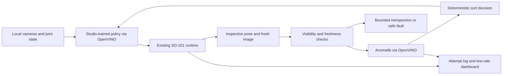

# Intel challenge: researched speed and reliability plan

Updated 14 November 2026, Helsinki. This is an engineering recommendation based on primary-source research and the saved station handoff, not a hardware benchmark or a guarantee of winning. Current upstream documentation can differ from the installed `junction2026` stack. Preserve the working environment; verify APIs against its exact versions before implementing.

## Decision

Build a locally running, learned inspection cell: **Studio-trained SmolVLA, Anomalib inspection, OpenVINO inference, and a deterministic state machine**. Keep a mentor-approved ACT fallback if SmolVLA export or training cannot meet the deadline. Use cloud GPUs for training; keep normal execution on the Intel laptop.

The best first optimization is eliminating stalls and failed attempts. Adding Gemma to the binary good/bad decision is unlikely to improve this fixed task: the anomaly model already provides the evidence, and a threshold/controller can route it without text generation. This is our architectural inference, not a measured comparison.

Priorities: stable local capture → complete autonomous loop → better demonstrations/inspection views → measured inference improvements → one bounded recovery feature → submission evidence.

## What our station actually needs

The [station handoff](ROBOT-STATION-HANDOFF.md) records successful calibration and XPU tensor execution, but also disconnected sessions, sampler stalls up to about 12 seconds, and a wrist-camera mitigation of 424×240 at 6 FPS. It does not establish that these problems still occur or that network backpressure was their cause. Dataset collection, training and anomaly integration were not established in that snapshot. At research time the solution repo contained documentation only. The customized UI has since been included in `../dashboard`; the original working copy remains outside the repo.

Before training, run a supervised local stability check on the Intel laptop. Measure capture intervals, frame age, policy latency and missed action deadlines independently. Compare local control with remote preview disabled/enabled, without running competing arm owners. Keep high-quality recording separate from a low-rate remote preview. At 6 FPS, frames are roughly 167 ms apart even before transport or processing; changing model speed cannot recover information never captured.

Do not blindly restore 30 FPS on every camera. Test actual USB bandwidth and the chosen camera set, use stable identities, preserve calibration, and match training/deployment camera names, crops, resolution, color order and action normalization. The latest handoff has newer network/camera information than the runbook’s original connection example.

## Model choices

| Component | Default | Alternative and gate |
|---|---|---|
| Learned arm policy | Existing Studio SmolVLA path, if export smoke test passes | ACT if mentors accept its role under the VLA rubric; preserve any already working trained policy |
| Inspection | First mentor-supported Anomalib baseline; absent one, try PatchCore | EfficientAD small only if detector inference materially limits the cycle and training/export succeeds |
| Sort/retry decision | Explicit state machine using validated detector output | No language model required |
| Operator language interface | Existing buttons | FunctionGemma only after core evidence is complete, with no direct motor access |
| Deployment | Explicit OpenVINO GPU/CPU comparison | NPU for a compatible vision model if measured end-to-end benefit or efficiency benefit justifies it |

**SmolVLA versus ACT.** SmolVLA conditions action chunks on images, robot state and language. Hugging Face recommends task-specific fine-tuning and roughly 50 episodes as a starting point, with repeated coverage of variations; that is not a universal sufficient dataset size. ACT is their lightweight imitation-learning starting point. Language-conditioned branching makes SmolVLA attractive for this rubric, while ACT is a fallback for a constrained task. A task string passed to ACT does not make it a language-following policy. [SmolVLA documentation](https://huggingface.co/docs/lerobot/main/smolvla), [ACT documentation](https://huggingface.co/docs/lerobot/main/act).

**PatchCore versus EfficientAD.** PatchCore stores normal patch features and uses nearest-neighbor distances. Its memory bank/coreset is therefore worth profiling as dataset size grows. EfficientAD uses student/teacher and autoencoder components; its training also uses ImageNette data. Treat it as a speed candidate with additional training/setup cost, not an automatic winner. Neither paper latency nor generic export support proves performance or NPU compatibility on our laptop. [PatchCore](https://anomalib.readthedocs.io/en/latest/markdown/guides/reference/models/image/patchcore.html), [EfficientAD](https://anomalib.readthedocs.io/en/latest/markdown/guides/reference/models/image/efficient_ad.html).

**Gemma answer.** FunctionGemma is a 270M function-calling model intended for specialization to a defined API; Google explicitly discusses fine-tuning for reliable task behavior. It fits parsing an operator request into an allowed task, not generating joint targets or replacing defect inspection. Gemma 3n supports multimodal inputs on consumer devices, but this is not evidence of a trained SO-101 action policy or superiority on our defect dataset. [FunctionGemma overview](https://ai.google.dev/gemma/docs/functiongemma), [Gemma 3n overview](https://ai.google.dev/gemma/docs/gemma-3n).

If we add FunctionGemma, restrict it to validated commands such as selecting a task while idle or explaining recorded results. Parse an allowlisted schema, reject unknown arguments, and require the existing explicit start control for motion. The controller owns limits, timeouts and stopping. A language interface must never be necessary to stop. Benchmark its latency separately and label it as usability, not a robot speed improvement. Do not add a cloud Gemini/LLM call to every cycle.

## Concrete architecture

Use states `READY → PICK → PRESENT → INSPECT → PLACE_GOOD/PLACE_BAD → VERIFY → READY`, plus bounded `REINSPECT` and `FAULT`. Each transition needs an observed condition and a timeout. Define a check for brick presence; a closed gripper alone does not prove a successful grasp. Verify placement visually where feasible; record uncertain completion honestly.

Train demonstrated subtasks or a supported conditioned policy so the detector decision reaches the placement behavior. Both branches need data. If the framework cannot switch language tasks mid-episode, implement mentor-approved skill boundaries rather than assume it can. At each branch change, discard stale queued actions and reset the policy's episode/chunk state using its supported interface. Never execute a previously queued good-bin trajectory after a defective decision.

Reuse the existing runtime, camera readers and dashboard. Exactly one process/session owns the arm. Put our orchestration, configuration and evidence in this repo, with a pinned upstream dependency or documented integration patch; do not duplicate robot drivers.

## Techniques ranked by expected value

### 1. Reduce failed attempts and unnecessary motion

Standardize lighting, background and a repeatable inspection pose. Position bowls to reduce travel while maintaining reachable, collision-free paths approved at the station. Record smooth demonstrations without long idle portions. Do not speed up by skipping trajectory points, changing the trained timebase, increasing torque, or bypassing limits. Shorter paths and fewer retries can improve throughput without faster motor commands.

Use a fixed inspection ROI only when the brick is reliably inside it. Check presence, visibility and blur before classifying; never crop away the defect-bearing face. Include legitimate colors, shadows and poses in normal data. Select defect thresholds on validation data and freeze them before held-out tests. Preserve the exported model's preprocessing and score normalization; avoid accidental double normalization.

### 2. Keep frames current and UI work off the critical path

Consume the newest valid camera frame rather than an accumulating FIFO of stale preview frames. Log capture and decision timestamps on a consistent clock. Keep dataset recording complete; dropping stale live-inference frames is a different operation from dropping training frames. Do not block arm control on JPEG encoding, remote WebSockets or dashboard rendering. First establish whether this bottleneck exists with timings before changing code.

After arrival at the inspection pose, require a fresh post-arrival frame and a validated settling/visibility check, rather than an arbitrary long sleep or a frame captured during travel. Give every wait a bound and fail safely when it expires.

### 3. Optimize the measured inference bottleneck

Compile/load models once, warm them before trials, use batch one and fixed input shapes where compatible. Start with OpenVINO's latency hint. Benchmark explicit CPU and GPU targets with identical inputs and preprocessing. Record requested and actual execution devices, precision, warm/cold times and package/driver versions. `AUTO` is not evidence that the NPU was used. Intel documents latency-oriented hints; NPU dynamic-shape support has version/compiler/driver constraints. [Performance hints](https://docs.openvino.ai/2026/openvino-workflow/running-inference/optimize-inference/high-level-performance-hints.html), [NPU device](https://docs.openvino.ai/2026/openvino-workflow/running-inference/inference-devices-and-modes/npu-device.html).

Candidate assignment: policy on iGPU, inspection on NPU or CPU, controller on CPU. Select by simultaneous workload measurements: sharing the iGPU may cause contention, but moving inspection can also add overhead. Compare cycle time and defect quality, not just isolated FPS. Stop NPU investigation after a proposed 45-minute compatibility timebox if it blocks the baseline; document the outcome accurately.

Try INT8 on the inspection model only after a working floating-point export. Use representative calibration data, validate on a separate labeled set, and reselect thresholds on validation only if score distributions change. Do not assume weight compression, activation quantization and reported device precision are interchangeable. Preserve a rollback artifact. Policy quantization is lower priority because small numerical errors can affect closed-loop behavior. [NNCF post-training quantization](https://docs.openvino.ai/2026/openvino-workflow/model-optimization-guide/quantizing-models-post-training/basic-quantization-flow.html).

### 4. Overlap action prediction with execution, only if supported

Current OpenVINO PhysicalAI documents `InferenceModel` action chunking and `AsyncExecution`, which predicts in a background thread. Prefer that existing abstraction if the installed event version and exported policy support it. Current upstream also has timestamped camera frames. These are research findings, not confirmed installed features. [PhysicalAI runtime](https://github.com/openvinotoolkit/physicalai).

Hugging Face's RTC additionally aligns overlapping predictions for supported flow-based policies such as SmolVLA; ordinary async execution is not automatically RTC. Integrating current LeRobot RTC into an older OpenVINO export may be substantial work. Do not upgrade the entire stack to obtain it during the hackathon. [RTC documentation](https://huggingface.co/docs/lerobot/main/rtc).

First log prediction time, remaining action horizon and underflows. A scheduling condition is `remaining_actions / action_rate > p95_prediction_time + measured_margin` when starting the next prediction. This is a planning bound, not a safe controller by itself. Use the policy's trained action rate; Studio's 100 Hz teleoperation loop is not proof the learned policy should run at 100 Hz. Reject expired predictions, bound queue depth, preserve stop responsiveness and validate transitions with the robot operator. Longer chunks reduce replanning frequency but increase open-loop exposure.

### 5. Add selective reinspection as the differentiator

On invalid visibility or a validation-defined ambiguous score band, perform at most one demonstrated, bounded second view. A clear defect should go straight to the defective destination. If still unresolved, enter a safe fault/manual-review state or an organizer-approved destination; never silently count it as a good result. Do not invent a third official category.

Log why reinspection happened, extra time, final decision and whether it recovered a genuinely failed baseline case. Score bands are operating heuristics, not calibrated uncertainty probabilities. This feature earns its place only if it reduces false accepts or improves correct sorts per minute in a controlled comparison.

## Experiments that decide what ships

Primary metric: **correct autonomous sorts / total wall-clock minutes**, accompanied by task success and defect false-accept counts. Include failed attempts, retries and manual reset time. A faster model that produces more failures can reduce throughput.

Illustrative calculation, not a measurement: if a 10-second cycle spends 0.2 seconds in inspection, halving inspection saves 0.1 seconds, about 1% of cycle time. If it instead waits one second between action chunks, eliminating that wait is a much larger opportunity. Measure phase times before choosing the optimization.

| Experiment | Keep constant | Promote only if |
|---|---|---|
| Local execution / remote preview comparison | Cameras, model, task | Reduced frame age/stalls, no lost stop control |
| Baseline vs improved ROI/lighting/data | Held-out objects and placements | Better defect operating point and task success |
| CPU vs GPU vs compatible NPU placement | Export, input, precision | Better cycle latency or measured efficiency without quality loss |
| Sync vs supported async | Policy, action rate, trial conditions | Fewer underflows and improved throughput without unsafe/discontinuous motion |
| Float vs INT8 inspection | Held-out set and scoring rules | Comparable defect quality plus material latency/efficiency gain |
| Recovery off vs on | Same condition mix | Lower failure/false-accept rate worth the retry time |

Proposed small final set: 30 attempts, half good and half defective, spread over nominal, shifted/rotated and cluttered conditions allowed by organizers. Use matched condition lists and alternate configuration order where practical. Do not train or tune on this final set. Log every attempt, including aborts. Thirty trials are demo evidence, not industrial reliability certification; report counts and sample size, not an unsupported 99.9% claim.

Minimum CSV fields: attempt ID, configuration/model hashes, object/condition, true label, predicted label, final destination, success, fault reason, manual intervention, retries, capture timestamp/frame age, pick/inspection/place/total durations, requested/actual devices. Report defect false accepts separately from false rejects, p50/p95 cycle latency and model-only latency. Measure energy per correct sort only if the measurement boundary is known; CPU-package power is not whole-system power.

## Remaining hackathon execution plan

Timeboxes below are recommendations from the moment the team starts, not claims about the current clock. Compress optional work to preserve the Sunday November 15 submission deadline from the saved participant guide.

| Gate | Owner | Exit condition |
|---|---|---|
| First 45–60 minutes | Integration + robot | Confirm live state, local stability, camera contract and exact software versions; smoke-test supported model export before committing to training |
| Next data/training block | Robot + vision | Start policy fine-tuning as soon as clean coverage exists; build first Anomalib baseline concurrently; verify both destination labels |
| Saturday integration checkpoint | All | At least one autonomous success for each branch, with detector controlling destination and attempts logged |
| After baseline works | Integration + evaluation | Profile phases; run only the top bottleneck optimization, then bounded recovery if time allows |
| Saturday evening | Evaluation + all | Freeze best configuration; collect held-out results and uninterrupted demo; prepare deck and backup artifacts |
| Sunday 08:00 | All | No new model/runtime migration; rehearse and verify accessible links |
| Sunday 09:00 target | Submission owner | Submission marked FINAL; saved official cutoff is 10:00 Helsinki |

If training takes hours, that changes the schedule: start it early, evaluate available checkpoints, and do not repeatedly restart full runs for cosmetic hyperparameters. Keep the same dataset schema across candidates. Collect additional demonstrations around actual failure modes, with supervised recovery; do not attempt online RL or a new world-model stack this weekend.

## What we show judges

An uninterrupted sequence containing good and defective bricks, a permitted shifted placement, and a genuine recovery case if it works. Overlay camera/heatmap, actual state, decision, elapsed time and execution device. Then show a small baseline-versus-final table with counts, latency and false accepts. Explain what was trained in Studio, what Anomalib detects, and what OpenVINO accelerates.

The saved kickoff rubric emphasizes complete integration, Anomalib, VLA/Studio, OpenVINO, reliability and innovation. Other published rubrics differ: confirm the authoritative version and ACT acceptability with mentors. No new claim about official scoring is made by this research. The strongest story is an affordable inspection cell taught by demonstration, running locally, with measured improvement and visible failure handling.

## Scope and limits

This research changed documentation only. No live robot commands, training jobs, package upgrades, model downloads or performance benchmarks were run. No cloud API or small decision model has demonstrated an advantage on our station. Source `main`/`latest` documentation is not a compatibility guarantee. The plan deliberately skips unproven motor-speed increases, custom RTC rewrites, large VLA migrations and a language model on the binary decision path.
