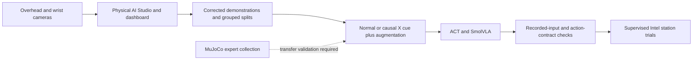

# Submission overview

## Problem and implementation

The SO-101 station must select a block from a cluttered scene and place it on the blue plate. We built a workflow spanning demonstration collection, dataset correction, comparative policy training, simulation and guarded Intel deployment.

## Contributions

- Dashboard integration with cameras, demonstration workflows and manual-jog backend controls.
- A 64-demonstration preparation pipeline preserving original recordings, using corrected task text, train-only statistics and reset-family splits (41/12/11 episodes).
- A factorial experiment matrix: ACT/SmolVLA, normal/X target cues, four cumulative augmentation recipes, real-only/real-plus-simulation data. Transformations are online rather than duplicated videos.
- Causal target marking: an initial human-selected point is tracked only while appearance/displacement checks pass. The marker disappears on loss. Training cannot assume a future grasp location is known at inference.
- MuJoCo scene, expert collection and LeRobot export with explicit transfer-quality gates.
- Intel/OpenVINO deployment experiments, output-contract audits and offline-tested bounds/visual-feedback utilities.

## Updated physical demonstration

The user supplied a physical sorting video after the initial submission draft and identified the controller as **SmolVLM-assisted vision-guided execution**. The video reports three completed good-to-blue sorts and a 48-second median cycle. Inspection confidence is marked partial. This updates the physical-demo evidence; it does not establish defect-branch reliability or ACT/SmolVLA policy success. See [video provenance](../evidence/physical-demo/supplied-video.json) and the [updated submission package](../submission/README.md).

## Verified results and limits

This is a repository snapshot prepared on **15 November 2026**, not a live training monitor.

| Area | Evidence-backed status | Limit |
|---|---|---|
| Dataset | 64 demonstrations prepared; fixed grouped splits and training-only statistics | Modest scene diversity; outcome review is sampled, not exhaustive |
| Experiment matrix | 32 configurations generated; real-only training launched across two hosts | No completed 32-run comparison; 16 synthetic-mixed variants remain gated |
| Augmentation | Deterministic transforms and sampler/resume logic have offline tests | More transformed samples do not equal independent demonstrations |
| Policy deployment | ACT/SmolVLA checkpoints evaluated; actual policy-driven motion tested | Reliable physical pick-and-place success has not been established |
| Action bounds | Recorded ACT out-of-range prediction reproduced on CPU; bounds/rejection logic tested | Projection does not fix policy quality or prove collision safety |
| Simulation | Collection/export and policy evaluation implemented | Camera/contact mismatch prevents claiming validated sim-to-real benefit |
| Intel integration | OpenVINO inference and station integration evidence retained | Earlier inspection results are not blue-plate task-success measurements |

The [evidence index](../evidence/README.md) links the underlying artifacts. Validation losses are meaningful within the same model/data protocol; they are not a substitute for comparable physical success rates.

## Review and reproduce

Start with the [code map](CODE-MAP.md), then run the root README's offline checks. Component READMEs describe dependencies and external inputs. A fresh clone includes source, annotations, configuration examples and evidence, but not private recordings, trained weights, downloaded simulation assets or credentials.

Hardware reproduction requires the actual station, measured calibration, matching camera views, a reviewed start state and supervised operation under the [runbook](ROBOT-STATION-RUNBOOK.md). Historical commands contain station-specific IDs and must not be copied blindly.
