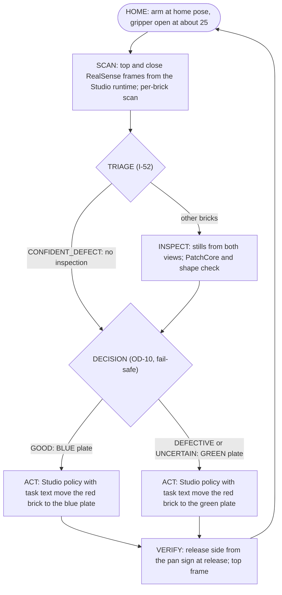
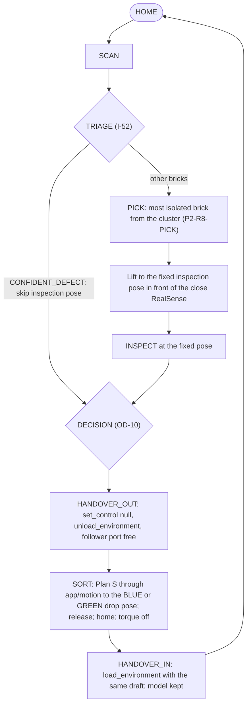

# Architecture: sorting cell (policy mode and scripted mode)

Status at 2026-11-14 15:11Z, revised after the 15:25Z decision corrections (D-070, D-080): build in progress; no take has run. Source keys are as defined in README.md (G, DEC, INS, LC, FL, PLAN, PROBE, BENCH, BSRC, EV, RULES, PLIVE, PRUN, ARM, TEL, GMB, GMG, T08, MODELS). Laptop root R = /home/intel/intel-junction-2026.

## 1. Policy mode (OD-12, I-52, LC section 8)

Policy mode uses the Studio-trained policy for the move and our code for the inspection and the routing [DEC D-060; LC section 8].

Notes, from the specs and the rules file:
- In its still_hires mode, INSPECT unloads the environment, takes 1280x720 stills from both RealSense views with locked exposure, runs the detector, and reloads [P2-B-LOOP2 section 1]. RULES sets the still size to 1280x720 and still.exposure to null, so a live start is refused until the exposure is calibrated [RULES; PLIVE]. The still device paths (/dev/video8 for top, /dev/video14 for close) are marked [unclear] in RULES.
- ACT ends on release, return or a timeout. The RULES timing block sets release_at 6.0 (gripper at or above 6 after a grasp), home_tol 10.0 (within 10 units of home), still_s 1.0 (still for 1 s) and act_timeout_s 45.0 [RULES]. The end-of-ACT code path in policy_cycle.py was not read in this run.
- A fail-safe rule applies: only an inspected GOOD goes to BLUE; every other outcome goes to GREEN [LC section 8]. RULES sets uncertain_margin 0.1, which turns GOOD scores within 10% of the threshold into UNCERTAIN; the value is marked [unclear] [RULES].

## 2. Scripted mode (OD-11b, LC sections 7 and 8)

Scripted mode picks the most isolated brick from the cluster, inspects it at a fixed pose, and sorts it with Plan S, the scripted motion [DEC OD-11; LC section 7].

Handover evidence: the probe connected at 14:13:27Z, loaded the environment by 14:13:29Z, loaded the model in 0.91 s, unloaded with the follower port free after 0.0 s, and reloaded without a model reload at 14:13:31Z [PROBE]. The probe model was the team's smoke model fa42ee76, used only as a test load [DEC D-066]. Gate G-A passed [DEC D-057].

## 3. Device placement (CPU, iGPU, NPU)

Hardware on the laptop [FL 11:40Z]: Intel Core Ultra X9 388H (Panther Lake), integrated GPU (xe, /dev/dri/renderD128), NPU (8086:b03e, intel_vpu, /dev/accel/accel0), 61 GiB RAM, Ubuntu 26.04.1 LTS, kernel 7.0.0-38. The benchmark names the devices CPU "Intel(R) Core(TM) Ultra X9 388H", GPU "Intel(R) Graphics [0xb080] (iGPU)" and NPU "Intel(R) AI Boost", on OpenVINO 2026.4.1 [BENCH].

The benchmark feeds the ACT IR with state [1,6], two RealSense images [1,3,384,384] and returns an action output of [1,100,6] [BENCH].

Run B, measured (p50 latency, and the throughput the file reports):

| Work | Device | Value (run B) | Source |
|---|---|---|---|
| ACT 389da0fd, IR as exported (FP32 weights), batch 1 | CPU | p50 83.279 ms; 11.769 inferences/s; compile 0.462 s | BENCH |
| same | GPU | p50 3.1851 ms; 291.284 inferences/s; compile 0.992 s | BENCH |
| same | NPU | p50 3.8307 ms; 252.008 inferences/s; compile 0.043 s | BENCH |
| ACT 389da0fd, compressed to FP16 weights, batch 1 | CPU | p50 80.3801 ms; 12.385 inferences/s; compile 0.504 s | BENCH |
| same | GPU | p50 3.2107 ms; 302.549 inferences/s; compile 0.663 s | BENCH |
| same | NPU | p50 3.8594 ms; 250.575 inferences/s; compile 0.043 s | BENCH |
| PatchCore detector IR, native batch 2 (FP16 weights) | CPU | p50 107.277 ms per batch; 8.819 batches/s (17.638 images/s) | BENCH |
| same | GPU | p50 8.4712 ms per batch; 116.296 batches/s (232.592 images/s) | BENCH |
| same | NPU | p50 81.6142 ms per batch; 12.111 batches/s (24.222 images/s) | BENCH |
| PaDiM detector IR, batch 1 | CPU | p50 7.378 ms; 132.802 inferences/s | BENCH |
| same | GPU | p50 1.4847 ms; 636.854 inferences/s | BENCH |
| same | NPU | p50 6.1837 ms; 158.509 inferences/s | BENCH |

Other work on the host, and the planned placement:

| Work | Device | Basis | Value | Source |
|---|---|---|---|---|
| PatchCore detector in the cell | GPU first, NPU time-boxed, CPU as baseline | DEC D-033, D-045; RULES detector block (device GPU) | Batch 1 per brick TBD; the bench measured batch 2 only | BENCH |
| ACT policy in the cell | Studio runtime (route A); device GPU set explicitly on every load_model (D-080). RULES plates still say device auto (lines 32 and 41) | RULES plates block; DEC D-080 | Replay of the same model through OpenVINO PhysicalAI InferenceModel, not the Studio runtime path; per query p50 and p95: GPU 9.29 and 11.23 ms; CPU (what auto resolves to, per D-080) 121.00 and 146.88 ms | RPL (replay_GPU.json, replay_CPU.json); RULES |
| Plan S motion, triage, state machine, logs | Host CPU (Python); no model | LC sections 4, 5, 7 | n/a | n/a |
| Telemetry sampler | Host CPU, 1 Hz (PERIOD_S = 1.0) | telemetry.py | Not a rubric value | R/logs/telemetry/20261114.jsonl [TEL] |
| Dashboard | Host CPU (stdlib server in the spec) | P2-B-DASH | TBD | not on disk |
| Studio backend and UI | Host, Studio's own processes (127.0.0.1:7860 and :3000) | FL 11:40Z | n/a | outside this pack |

Caveats on the run B rows:
- Not precision-matched. The bench reads the device's INFERENCE_PRECISION_HINT after compile, not a value it sets. That property reads float32 on CPU and float16 on GPU and NPU in all 12 rows [BENCH; BSRC]. The two ACT rows differ in IR weight precision, not in the device hint.
- Thermal: all four ACT GPU and NPU timed windows had 0 telemetry samples (0.661 to 0.798 s), while the ACT CPU windows had 16 and 17 samples [BENCH]. Thermal numbers for ACT are therefore CPU-only.
- The machine was not quiet by the measured load: the 1-minute load before each timed window ranged from 3.18 to 7.82 [BENCH].

## 4. Interfaces and events

- Run folder: the contract names R/logs/loop/<run_id>/ with events.jsonl, frames/ and control.json, plus a symlink R/logs/loop/current [LC section 5]. RULES sets logs_root to R/logs/loop_v2 [RULES]. Neither folder exists (checked 15:08Z). The path is open (README section 8, item 4).
- Event types in EV (events.py, lines 26-29): scripted mode run_start, state, skill_start, skill_end, inspection, inspect_cameras, handover, align, sort_start, sort_end, stats, error, heartbeat, run_end and control; policy mode scan, triage, decision, policy_run and verify [EV]. The field lists for scan, triage, inspection, decision, policy_run and verify are in LC section 8; they were checked against the contract text only, not the code.
- Control commands read from control.json: start, pause, resume, next, stop and quit [EV].
- Studio runtime: project ab767473-d6fd-47ff-812e-8239c455dabb; follower e5600356-6296-496e-8344-17995e419baf; recording cameras 1d80a0dd-8f62-4f23-ae29-2f1fe406dde9 and b6e5da09-28f2-4208-9d15-526580074c75 [LC section 1; RULES studio block]. The RULES comments map 1d80a0dd to the close low RealSense (243722064316) and b6e5da09 to the top RealSense (243622061421). Those comments are not checked against the live camera list.
- Route A (Studio runtime WebSocket) is the decided path [DEC D-042]. The offline runner (app/ovrun/runner.py) is the fallback behind it [DEC D-080]; P2-B-OVRUN evaluated its replay, and those numbers are in the device row of section 3.

## 5. Isolation and data boundaries

- Team workspaces are not read or used [INS I-54; DEC D-066].
- Simulation data is not used for training or detection [DEC D-069].
- The follower is reached only through the by-id path of serial 5B3D040939 [FL 13:42Z; RULES paths block; GMB line 1].

## 6. Open items

1. No runnable loop entry point: tools/run_policy.py is absent, policy_run.py has no __main__ entry, and no orchestrator with a dry-run flag exists (checked 15:08Z) [PRUN].
2. No dashboard on disk (app/dashboard absent, checked 15:08Z).
3. Run folder path conflict: logs/loop (LC section 5) against logs/loop_v2 (RULES).
4. Two copies of studio_runtime_client.py (app/loop and app/loop_v2/app/loop).
5. The ACT device is GPU by rule (D-080), but RULES plates still say device auto (lines 32 and 41). A precision-matched rerun is still open. The NPU rows are present (run B).
6. Power and energy per inference cannot be measured without root [BENCH power block].
7. PatchCore batch 1 per brick is not benchmarked: the bench IR is batch 2.
8. The arm state read BUSY at 15:08:09Z (pid 1436289) [ARM].

## Coverage checklist (internal, for review; remove before publishing)

- [x] LC sections 1, 4, 5, 6, 7, 8 read (earlier run); the section 5 path line re-checked at 15:08Z.
- [x] DEC D-033, D-042, D-045, D-057, D-060, D-063, D-066, D-069, OD-10, OD-11, OD-12 read (earlier run); D-063 re-read at 15:10Z.
- [x] INS I-52, I-54 read (earlier run).
- [x] PLAN section 1 (changes) and section 2 (gates) read (earlier run).
- [x] P2-B-LOOP2 section 1 and 2 read (earlier run); P2-B-DASH read; P2-R8-PICK read.
- [x] PROBE log (earlier run); BENCH run B (full JSON and summary, this run); BSRC grep (this run); EV, RULES, PRUN, PLIVE grep (this run); TEL tail, ARM, ps, logs and app directory listings (this run).
- [ ] P2-B-DET2 report, P2-R8-PICK offline_eval, P2-B-OVRUN report: not opened (not in inputs or not on disk yet).
- [x] Correction pass (15:25Z to 15:31Z): DEC D-070 (corrected) and D-080 read in full; RAS recipe lines 38-47 and the InferenceModel grep (0 matches, both RAS copies); JUNCTION2026.md line 122; RULES lines 24-44; bench_ov.py line 77; replay_CPU.json, replay_GPU.json and replay_summary.json (CPU block). The physicalai code lines cited by D-080 were not found on disk and are not verified here. The P2-B-OVRUN replay JSON files were read; the P2-B-OVRUN report was not.
